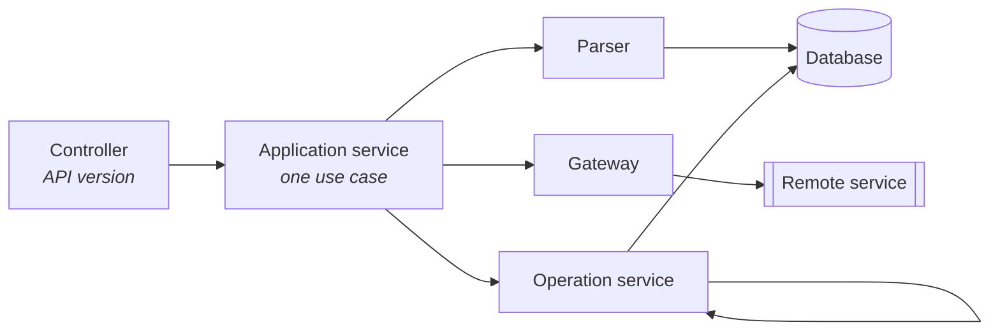
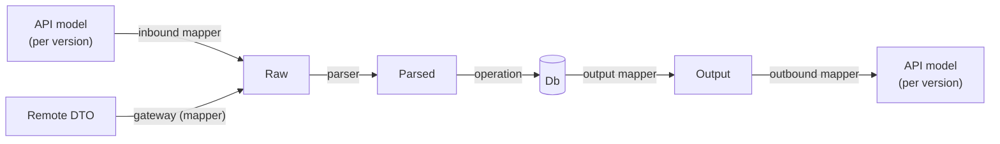
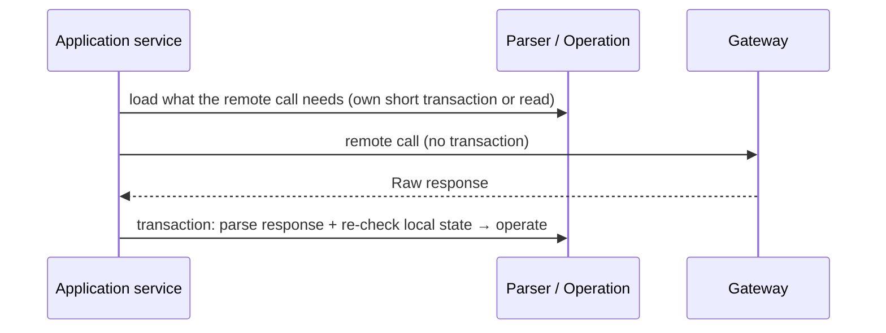
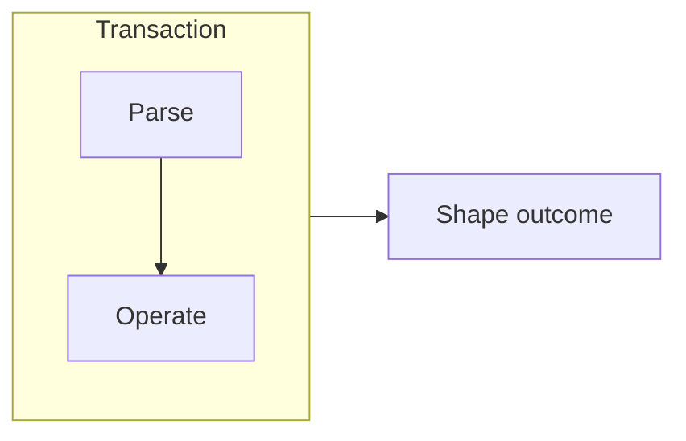
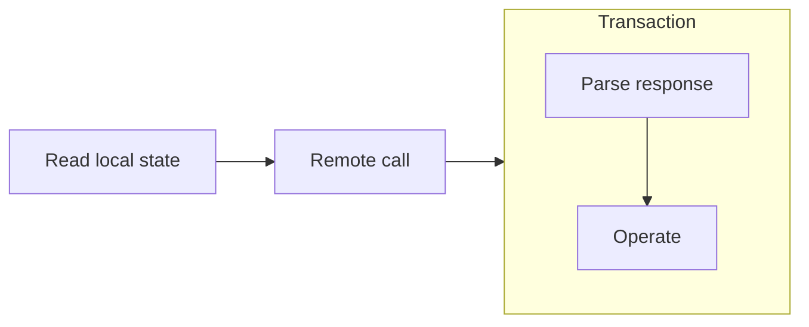
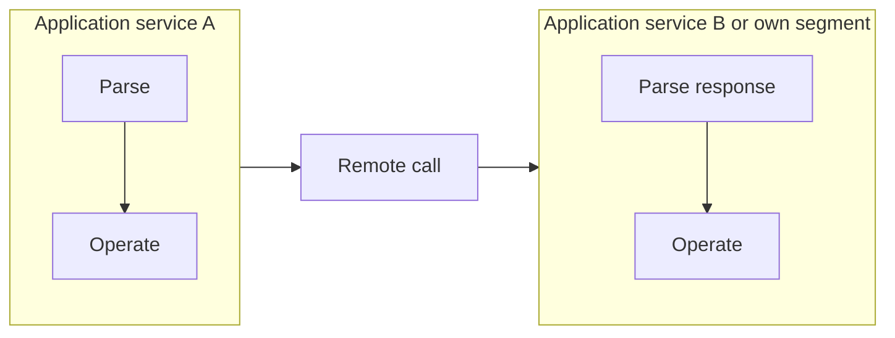

# BPDM Application Code Guide

This guide describes how we design **application code** in BPDM services: the code between a REST endpoint or a scheduled
trigger and the database or a remote service. It applies to Pool, Gate, Orchestrator and every service added later.

---

# Part 1 — The Big Picture

*Explanatory. The binding rules are in [Part 2](#part-2--rules).*

## 1.1 Components

A **use case** is anything the service does: an endpoint call or a background job. Each use case is one
**application service**. It tells the whole story of the use case from top to bottom and is written for a reader, not
for reuse. It achieves its story with a **toolbox** of reusable components:

| Component             | Job                                                                                         | Purity                          |
|-----------------------|---------------------------------------------------------------------------------------------|---------------------------------|
| **Parser**            | Turns untrusted data into data an operation may rely on: normalize, validate, resolve.     | Reads the database, never writes |
| **Operation service** | Carries out the service logic: invariants, state transitions, writes, changelog.           | Reads and writes the database   |
| **Gateway**           | Talks to one remote service and translates its models into ours.                          | Remote I/O only, no database    |
| **Mapper**            | Translates one model layer into another.                                                   | Pure                            |

Around them sit the **controllers**, the presentation boundary: they speak one API version, decode the wire format
and hand the application service API-neutral data.

## 1.2 Models

Data changes its *guarantee level* as it flows through a use case. Each level is its own model layer. The diagram below
shows the order in which data passes through the layers during a use case; which layer may reference which is a
separate matter, settled by MDL.2.

| Layer      | Suffix                         | Guarantees                                                                                                     |
|------------|--------------------------------|----------------------------------------------------------------------------------------------------------------|
| API        | `…V7Dto`, `…V7Request`, …     | The wire contract of one API version. Lives only at the controller boundary.                                   |
| Raw        | `…Raw`                         | None. Anything that has not passed a parser: API input, remote responses, data prepared for a remote call. Raw from a controller MAY rely on CTL.3. |
| Parsed     | `…Parsed`                      | Normalized, validated, resolved. Each type stands for one documented set of guarantees.                       |
| Output     | `…Record`, `…Result`, `…Stats` | What a use case hands back to the controller. No entities.                                                    |
| Entity     | `…Db`                          | The persisted state. Trusted without parsing.                                                                  |

Each major API version owns a complete copy of every type it exposes. A version is frozen once superseded: when the
internal model changes, only that version's mappers change. This is what lets several versions live side by side
without one dragging the other along.

## 1.3 How a use case flows

The default use case is one **parse → operate** chain inside one transaction: the parser resolves and validates
everything the operation needs, the operation decides and writes, the application service shapes the outcome.

Remote calls change that picture. They are slow, can fail independently, and must not hold a database transaction
open. So the use case **splits its chain around every remote call**:

Data a remote call needs is loaded first, by parsers and operations; the gateway only sends and translates. The
response comes back as Raw and is parsed like any other untrusted input. Because local state may have changed while
the call ran, the parser of the next segment re-resolves what it relies on and rejects stale data.

An application service MAY call another application service. No rule forbids it, but the shape above usually does: a
segment parses everything before it operates, and calling another application service in the middle of a segment
would run that service's parse → operate chain inside our own, operating before we have finished parsing. So within a
segment, the outer use case composes the inner one's parsers and operations instead. At a remote call boundary the
chain splits anyway, and a complete segment on either side of the call can be another application service.

## 1.4 Typical structures

Most application services take one of three shapes.

**Local use case.** No remote call: one parse → operate chain inside one transaction. Most endpoints look like this,
for example the business partner input upsert.

**Remote round trip.** Remote calls surround the parse → operate chain: the local state the call needs is read first,
the remote service is called without a transaction, and the response is parsed and operated on in a transaction of its
own. A remote write follows the commit of the transaction that prepared it. Background jobs that fetch from another
service look like this, for example the resolution of finished golden record tasks.

**Composed use case.** The application service calls other application services, each a complete parse → operate
segment, and places the remote calls between them. It suits a use case whose segments are use-case-shaped on their own,
for example the relation task creation: one application service prepares the staged relations, the gateway creates
the tasks, and a final segment records them.

---

# Part 2 — Rules

*MUST / MUST NOT are binding. SHOULD is the default; its exception clause names the case we had in mind. MAY is
permitted, not expected.*

*Rule IDs are stable: a new rule is appended to its section, a removed rule leaves a gap, and no ID is ever reused.*

## 2.1 API models (`API`)

- **API.1** Each major API version MUST own a complete set of its types (models, enums, error codes, interfaces,
  clients) in its own `v<N>` package. A version MUST NOT reference another version's types.
- **API.2** Every API type MUST carry its version in its name (`RelationV7Dto`, `RelationTypeV7`, `GateErrorCodesV7`).
- **API.3** API types MUST NOT appear outside controllers and their version's mappers. Shared enums from `bpdm-common`
  MAY be used throughout.
- **API.4** A superseded API version MUST NOT change. Changes to the internal model MUST be absorbed by that version's
  mappers.

## 2.2 Controllers (`CTL`)

- **CTL.1** A controller MUST only: authorize, decode the wire format into Raw (JSON, CSV), resolve request context such
  as the tenant, call one application service, and map its Output or rejection to the API version's response.
- **CTL.2** A payload the controller cannot decode (invalid JSON or CSV syntax) MUST be rejected at the controller as a
  presentation error, never handed to a parser.
- **CTL.3** A controller MUST reject, as a presentation error, a request that violates a constraint formally declared in
  the API version's OpenAPI specification: data type, required field, enum value, format, length or size bound. Raw
  types MAY rely on these constraints. Every other constraint — anything stated only in prose descriptions, cross-field
  rules, references to existing data, business rules — MUST be left to the parser. The test: the controller rejects
  exactly what a client could have detected from the specification alone.

## 2.3 Application services (`APP`)

- **APP.1** Every use case — endpoint or background job — MUST be entered through exactly one application service,
  independent of API versions.
- **APP.2** An application service SHOULD implement its use case by composing the toolbox, and MUST NOT access the
  database or speak a remote protocol itself. It owns the transactions and shapes the outcome. It MAY make decisions
  that belong to its use case alone: which operation to run, whether a step is needed, how to react to a rejection. A
  decision that protects persisted state — an invariant, a state transition, a stale guard — MUST live in an operation,
  because every use case that writes that state must obey it.
- **APP.3** An application service SHOULD run one parse → operate chain inside one transaction.
  *Exception:* a use case with remote calls splits its chain at each call — see APP.4.
- **APP.4** A transaction MUST NOT span a remote call. Remote reads happen before the transaction that uses them; remote
  writes happen after the transaction that prepared them has committed.
- **APP.5** An application service MUST return Output models — a sealed `…Result` where a use case can be rejected — and
  MUST NOT throw to signal a rejection. Background use cases MUST report rejections (log, failed state), not throw.

## 2.4 Parsers (`PRS`)

- **PRS.1** Every model that does not come from our own database MUST pass through a parser before an operation receives
  it — API input and remote responses alike.
- **PRS.2** A parser MUST NOT write. It MUST return rejections as a `ParseResult` failure, accumulating every error it
  finds.
- **PRS.3** A parser MUST resolve every reference the operation needs to the entity it names; a missing referent is a
  parse error.
- **PRS.4** A parser MUST make business decisions only in the form of validation: whether data is acceptable. What to
  do with valid data — classify, transition, skip as stale — is the operation's call.
- **PRS.5** A parser that can reject nothing MUST return its Parsed value directly, without a `ParseResult`.
- **PRS.6** Parsers MAY call other parsers; reuse is their purpose.

## 2.5 Operation services (`OPS`)

- **OPS.1** An operation service MUST hold the service logic that protects persisted state: invariants, state
  transitions, change detection, writes. It MUST be the single place an aggregate is written, including its changelog
  and persisted-change log line.
- **OPS.2** An operation service MUST take Parsed models or entities and return entities, Parsed models, or the Raw models
  a remote call needs. It MUST NOT build Output, and MUST NOT call gateways.
- **OPS.3** Operation services MAY call other operation services; reuse is their purpose.
- **OPS.4** An operation service MUST NOT exist only to pass through what a parser already resolved.

## 2.6 Gateways (`GW`)

- **GW.1** A gateway MUST wrap exactly one remote service and do translation only: protocol, chunking, paging, and
  mapping remote models to and from internal models. It MUST NOT parse, decide, access the database or open
  transactions.
- **GW.2** A gateway MUST expose collection-based methods only; remote calls are coarse-grained.
- **GW.3** Remote models MUST NOT appear outside gateways and their mappers.

## 2.7 Internal models (`MDL`)

- **MDL.1** Internal models MUST belong to exactly one layer — Raw, Parsed, Output — or be an entity, and carry its
  suffix (`…Raw`, `…Parsed`, `…Db`; Output by role: `…Record`, `…Result`, `…Stats`). Enums need no suffix. They live in
  `model/{raw,parsed,output}/<domain>`, where the domain is the thing described, not the system it comes from.
- **MDL.2** A type MAY reference only its own layer and the layers it is built from: Output → Parsed → Raw. Parsed MAY
  reference entities; Raw and Output MUST NOT.
- **MDL.3** A Parsed type MUST stand for exactly one set of guarantees and document, in its KDoc, the validation
  guarantees its structure does not show. An operation chooses the guarantees it relies on by choosing its parameter
  type.
- **MDL.4** A Parsed type SHOULD reuse Raw types for parts that carry no guarantee of their own.
  *Exception:* a part gets its own Parsed type once an operation relies on a guarantee about it.
- **MDL.5** A batch MUST be a plain list unless the operation relies on a cross-entry guarantee or the entries were
  resolved against shared context (e.g. one tenant); then it gets its own `…BatchParsed`.
- **MDL.6** Parse errors MUST be sealed hierarchies in the Parsed layer, mapped exhaustively to API error codes by each
  API version's mapper.
- **MDL.7** Parse errors SHOULD live in one `model/parsed/error` package instead of their domain package. Kotlin requires
  the direct subtypes of a sealed type to share its package, so only errors in the same package can share an error
  across hierarchies.

## 2.8 Mappers (`MAP`)

- **MAP.1** A mapper MUST translate only: no decisions, no business-rule defaults, no I/O. It is a `@Component` in the
  `mapper` package.
- **MAP.2** There SHOULD be one mapper class per layer boundary, named by the boundary: internal ones by layer pair
  (`RawToParsedMapper`, `DbToOutputMapper`), external ones by system and direction (`ApiV7InboundMapper`,
  `PoolInboundMapper`, `OrchestratorOutboundMapper`).
  *Exception:* a boundary class that grows too large to navigate is split by domain (e.g. `ApiV7RelationMapper`), never
  finer.
- **MAP.3** Wire-format codecs (CSV reading and writing) are not mappers and MAY live beside the API mappers.
- **MAP.4** Services SHOULD translate between models through mappers.
  *Exception:* a short, single-use translation MAY stay inline.

## 2.9 Batches & transactions (`TX`)

- **TX.1** Every layer MUST preserve order: the i-th result belongs to the i-th entry. New APIs MUST NOT introduce a
  client-supplied correlation index.
- **TX.2** Parsers and operations MUST query and write per batch, not per entry.
- **TX.3** A parser SHOULD be `@Transactional(readOnly = true)` when it issues more than one query.
  *Exception:* a parser only ever called inside its application service's transaction may rely on it.

---

## NOTICE

This work is licensed under the [Apache-2.0](https://www.apache.org/licenses/LICENSE-2.0).

- SPDX-License-Identifier: Apache-2.0
- SPDX-FileCopyrightText: 2023,2026 ZF Friedrichshafen AG
- SPDX-FileCopyrightText: 2023,2026 SAP SE
- SPDX-FileCopyrightText: 2023,2026 Bayerische Motoren Werke Aktiengesellschaft (BMW AG)
- SPDX-FileCopyrightText: 2023,2026 Mercedes Benz Group
- SPDX-FileCopyrightText: 2023,2026 Robert Bosch GmbH
- SPDX-FileCopyrightText: 2023,2026 Schaeffler AG
- SPDX-FileCopyrightText: 2023,2026 Contributors to the Eclipse Foundation
- Source URL: https://github.com/eclipse-tractusx/bpdm
